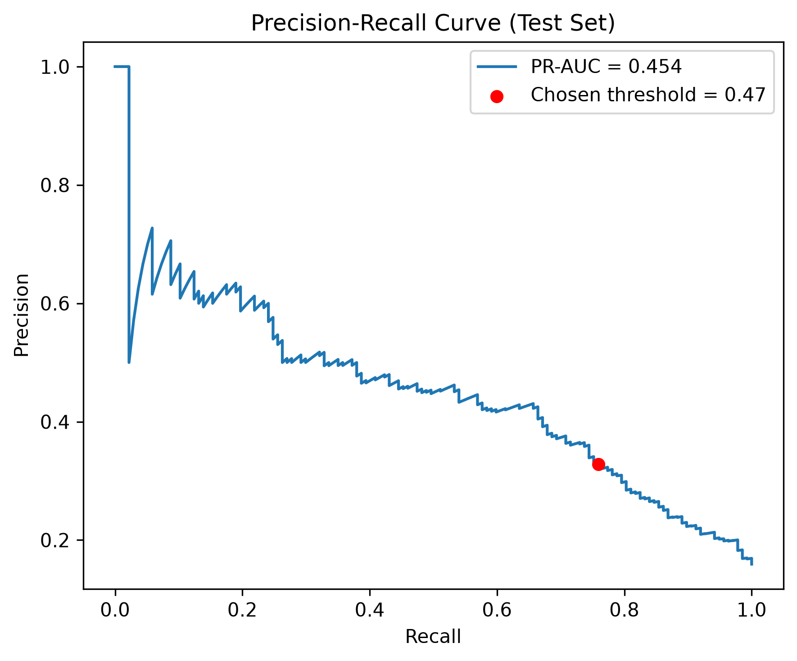

# Hearing Loss Prediction from NHANES Data (2015–2016)

Predicting the presence of hearing loss from demographic, occupational, and health data collected in the CDC's National Health and Nutrition Examination Survey (NHANES), 2015–2016 cycle. 


## Project Background

Hearing loss is under-diagnosed in the general population, and a lot of the risk factors such as age, noise exposure, certain chronic conditions and many more, are already sitting in routine health data. I wanted to see how well a model could flag the risk of hearing loss using only this kind of general information, without a hearing test. I used NHANES as a large and publicly available dataset to test this on.
I have been trained and worked as an audiologist before starting my Master's degree in Computer Science, and this project is my way of bringing those two backgrounds together. 


## Dataset

The analysis uses eight modules from the **NHANES 2015–2016** survey cycle:

| Module | Data included |
| --- | --- |
| `DEMO_I` | Age, sex, education, income-to-poverty ratio, military service |
| `AUX_I` | Pure-tone audiometry thresholds used to define hearing loss |
| `AUQ_I` | Occupational and firearm noise exposure, hearing protection |
| `BPX_I` | Systolic blood pressure |
| `BMX_I` | Body mass index (BMI) |
| `PBCD_I` | Blood lead and cadmium concentrations |
| `MCQ_I` | History of cardiovascular conditions and cancer |
| `DIQ_I` | Diabetes status |

The final study cohort contained **3,248 adults aged 20–69** with complete audiometric examinations. The initial analysis considered **22 candidate predictors**.

### Outcome Definition

The primary target, `hl_presence`, was derived from the **worse-ear pure-tone average (PTA)** across 0.5, 1, 2, and 4 kHz:

- **Hearing loss (`1`):** PTA > 25 dB HL
- **No hearing loss (`0`):** PTA ≤ 25 dB HL

An additional variable, `hl_severity`, categorizes hearing loss as normal, mild, moderate, or severe. It is retained for possible future multiclass analysis; the models presented here predict the binary outcome only.

Detailed variable definitions are available in the [data dictionary](sql/data_dictionary.md).

## Data Pipeline

I downloaded the raw NHANES SAS transport files (`.XPT`), loaded them into **PostgreSQL running in Docker**, and used SQL to join the survey modules, recode responses, and calculate audiometric outcomes. The processed data was then analyzed and modeled in Python.

| Stage | Script or notebook | Main task |
| --- | --- | --- |
| Data download | `src/raw_data_downloader.py` | Download eight NHANES modules |
| Database ingestion | `src/raw_data_to_postgress_loader.py` | Load raw survey data into PostgreSQL |
| SQL processing | `sql/nhanes_master_table_query.sql` | Join modules, process survey codes, calculate PTA |
| Data export | `src/processed_sql_to_csv.py` | Export the analytical table to CSV |
| Exploratory analysis | `notebooks/eda.ipynb` | Examine distributions, missingness, and predictor relationships |
| Data cleaning | `notebooks/cleaning.ipynb` | Handle missing values and create a stratified 80/20 train-test split |
| Model development | `notebooks/feature_preparing.ipynb` | Preprocess features, compare models, tune the threshold, and evaluate performance |

## Exploratory Data Analysis

### Missing Data

The pattern of missing values required particular attention because some NHANES questions are conditional on earlier responses.

- **Survey skip logic:** Some occupational noise and firearm-related questions were not asked when a participant reported no relevant exposure. This produced approximately **67% missing values** in certain variables. Where the parent question provided enough information, I recoded these entries to represent non-exposure.
- **Laboratory subsampling:** Lead and cadmium measurements were unavailable for approximately **55% of participants**, reflecting NHANES laboratory subsampling rather than ordinary questionnaire nonresponse.


### Patterns Associated with Hearing Loss

**19.5%** of participants met the study definition of hearing loss, compared with **80.5%** without hearing loss. This imbalance informed the choice of evaluation metrics.

Age showed the clearest relationship with hearing loss. Higher prevalence was also observed across several noise-exposure categories and among participants reporting diabetes or cardiovascular conditions. BMI and systolic blood pressure showed smaller differences between groups. These are descriptive associations and should not be interpreted as causal effects.


Additional visualizations, including feature distributions and correlation matrices, are available in [`images/eda_results/`](images/eda_results/).

## Model Development and Results

Five classifiers were evaluated using **5-fold stratified cross-validation**. Because hearing loss was present in fewer than one in five participants, I used **precision-recall AUC (PR-AUC)** as the primary model comparison metric instead of accuracy alone.

| Model | Mean cross-validation PR-AUC |
| --- | ---: |
| **Logistic regression (class-weighted)** | **0.475** |
| Random forest | ~0.44 |
| XGBoost | ~0.43 |
| K-nearest neighbors | ~0.38 |
| Gaussian naive Bayes | ~0.36 |

Class-weighted logistic regression achieved the highest mean PR-AUC in this comparison. More complex models did not improve performance on this dataset, although these results do not establish why the models differed.

### Classification Threshold and Test Performance

For an application focused on identifying potential cases, **recall (sensitivity)** is particularly relevant. I therefore tuned the classification threshold using **out-of-fold cross-validation predictions** and the **F2 score**, which gives recall more weight than precision. The held-out test set was reserved for final evaluation.

| Metric | Cross-validation | Held-out test set (20%) |
| --- | ---: | ---: |
| PR-AUC | **0.475** | **0.454** |
| F2 score | **0.637** | **0.602** |
| Recall (sensitivity) | Not reported | **0.759** |
| Precision (positive predictive value) | Not reported | **0.329** |

On the held-out test set, the model identified approximately **76% of participants with hearing loss**. Its precision of **32.9%** means that approximately one in three participants predicted to have hearing loss met the study's audiometric definition.

This trade-off may be relevant to screening-oriented research, but the relatively high number of false positives is an important limitation. Clinical usefulness would require independent validation and assessment of the consequences of both missed cases and unnecessary referrals.




The [logistic regression coefficient plot](images/model_training_results/Coefficients.png) provides a view of the model's learned associations. The coefficients should not be interpreted as causal effects.

## Key Analytical Decisions

### 1. Distinguishing Survey Skip Logic from Missing Responses

Treating every missing value the same way would have discarded useful information. For questions skipped because of a preceding response, I used the survey logic to recode values when non-exposure could be inferred. Other missing values were handled through median or mode imputation, as appropriate.

### 2. Processing Special Audiometry Codes

NHANES audiometry includes special values that cannot be treated as ordinary hearing thresholds:

- **`666`:** No response at the audiometer's maximum output. I recoded these values to the corresponding maximum threshold rather than excluding participants who may have severe hearing loss.
- **`888`:** The examination could not be completed. I treated these values as invalid or missing readings.

These decisions affect how the hearing-loss outcome is calculated, so they were handled before target construction.

### 3. Evaluating Lead and Cadmium as Predictors

Because lead and cadmium were missing for approximately 55% of the cohort, I tested their contribution before deciding whether to retain them. I used `IterativeImputer` with age and blood pressure, then compared cross-validated PR-AUC for linear and tree-based models with and without these biomarkers.

Including the biomarkers did not produce a meaningful performance improvement in these experiments, so I excluded them from the final predictor set.

### 4. Tuning the Decision Threshold Without Using the Test Set

Rather than applying the default 0.5 classification threshold, I selected a threshold that maximized F2 using out-of-fold predictions from the training data. This allowed the final test set to remain separate from the threshold-selection process.

## Limitations

- **Cross-sectional data:** The analysis identifies associations and evaluates prediction, but it cannot establish causal relationships.
- **Survey design:** NHANES sampling weights were not applied. Reported prevalence and performance metrics describe the analyzed sample and should not be interpreted as nationally representative estimates.
- **Limited validation:** The model was evaluated using one NHANES cycle, without external validation in another survey cycle or clinical population.
- **Moderate predictive performance:** Recall was 0.759, but precision was only 0.329 at the selected threshold. The model is not ready for clinical use.

## Project Structure

```text
├── data/
│   ├── raw/                         # Downloaded NHANES files
│   └── processed/                   # Analytical data and train/test splits
├── notebooks/
│   ├── eda.ipynb                    # Exploratory analysis
│   ├── cleaning.ipynb               # Cleaning and train/test split
│   └── feature_preparing.ipynb      # Model training and evaluation
├── images/
│   ├── eda_results/
│   └── model_training_results/
├── report/                          # Project report
├── sql/
│   ├── nhanes_master_table_query.sql
│   └── data_dictionary.md
├── src/
│   ├── raw_data_downloader.py
│   ├── raw_data_to_postgress_loader.py
│   └── processed_sql_to_csv.py
├── .env.example
├── docker-compose.yml
├── requirements.txt
└── README.md
```

## Tools and Libraries

- **Data processing:** Python, pandas, NumPy, SQL, PostgreSQL, SQLAlchemy, psycopg2, pyreadstat, pyarrow
- **Machine learning and statistics:** scikit-learn, XGBoost, SciPy, statsmodels
- **Visualization:** Matplotlib, Seaborn, missingno
- **Development environment:** Docker, Docker Compose, JupyterLab

## Getting Started

### 1. Clone the Repository and Install Dependencies

```bash
git clone https://github.com/kasrabghr/nhanes_hearing_loss_predictor.git
cd nhanes_hearing_loss_predictor
python -m venv .venv
```

Activate the virtual environment:

```bash
# Windows PowerShell
.venv\Scripts\Activate.ps1

# macOS / Linux
source .venv/bin/activate
```

Then install the packages:

```bash
pip install -r requirements.txt
```

### 2. Configure the Database

Copy `.env.example` to `.env` and update the settings if necessary. The example configuration uses PostgreSQL on host port `5433`.

### 3. Start PostgreSQL

```bash
docker compose up -d
```

### 4. Download and Load the Data

```bash
python src/raw_data_downloader.py
python src/raw_data_to_postgress_loader.py
```

### 5. Build and Export the Analytical Table

Run `sql/nhanes_master_table_query.sql` in a PostgreSQL client connected to the local database (for example, `psql`, pgAdmin, or DBeaver). Then export the result:

```bash
python src/processed_sql_to_csv.py
```

### 6. Run the Notebooks

Open JupyterLab and run the notebooks in this order:

```bash
jupyter lab
```

1. `notebooks/eda.ipynb`
2. `notebooks/cleaning.ipynb`
3. `notebooks/feature_preparing.ipynb`

### 7. Stop the Database

```bash
docker compose down
```

The database volume is retained when the container is stopped this way.

## Contact

**Kasra Bagherian**  
[Email](mailto:kasra.bghr@gmail.com) | [LinkedIn](https://www.linkedin.com/in/kasrabagherian/) | [GitHub](https://github.com/kasrabghr)
