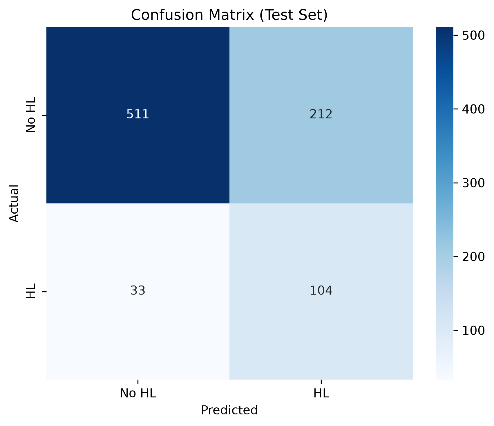
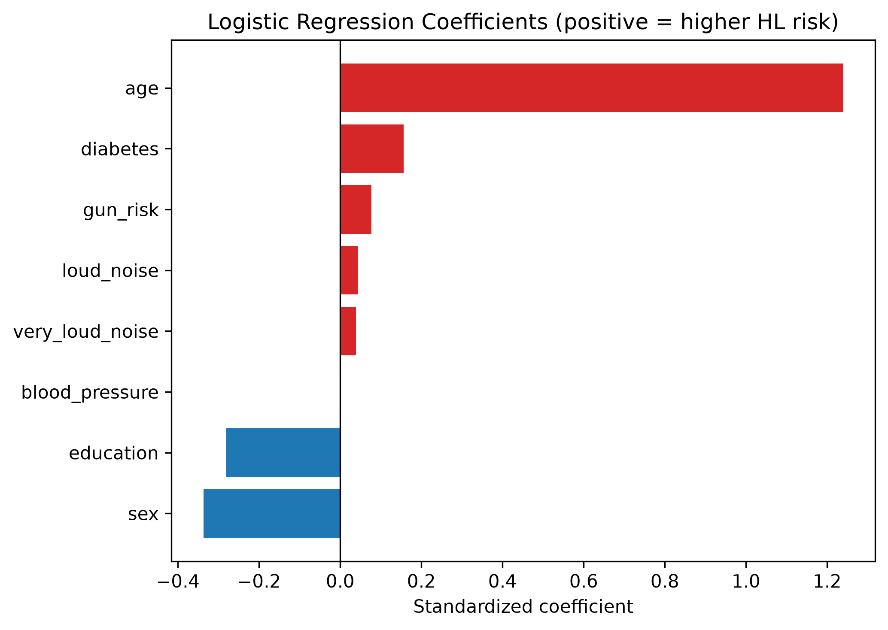

# Hearing Loss Prediction from NHANES Data (2015–2016)

Predicting the presence of hearing loss from demographic, occupational, and health data collected in the CDC's National Health and Nutrition Examination Survey (NHANES), 2015–2016 cycle.

## Why this project

I have been trained and worked as an audiologist before starting my Master's degree in Computer Science, and this project is my way of bringing those two backgrounds together. Hearing loss is under-diagnosed in the general population, and a lot of the risk factors such as age, noise exposure, certain chronic conditions and many more, are already sitting in routine health data. I wanted to see how well a model could flag the risk of hearing loss using only this kind of general information, without a hearing test. I used NHANES as a large and publicly available dataset to test this on.

## Data

NHANES 2015–2016, pulled from eight survey modules: demographics, audiometry, audiological questionnaire, blood pressure, body measures, blood lead/cadmium, medical conditions, and diabetes. Raw `.XPT` files are downloaded directly from the CDC, loaded into a local PostgreSQL database (each of these steps have been done with a reproducible script), and combined into a single feature table via SQL.
The outcome variable, `hl_presence`, is derived from the audiometry exam: a binary indicator of whether a person's worse-ear pure tone average (PTA) exceeds 25 dBHL. A severity column (`hl_severity`) was also built from the same PTA data during feature extraction as well. I haven't used it for my current model as it is ,at least for now, just a binary model to predict the presence of hearing loss, but I am planning to use this column in the future for a multiclass classifier to predict the severity of hearing loss.

Data dictionary: [`sql/data_dictionary.md`](sql/data_dictionary.md)

## Pipeline

| Step | Action (Script / Notebook) | Input | Output |
| :--- | :--- | :--- | :--- |
| **1. Download** | `src/raw_data_downloader.py` | CDC Servers | `data/raw/*.XPT` |
| **2. Load** | `src/raw_data_to_postgress_loader.py` | `data/raw/*.XPT` | PostgreSQL Database |
| **3. Query & Export** | `sql/nhanes_master_table_query.sql`<br>(via `src/processed_sql_to_csv.py`) | PostgreSQL Database | `data/processed/raw_master_table.csv` |
| **4. Explore** | `notebooks/eda.ipynb` | `raw_master_table.csv` | `post_eda_master_table.parquet` |
| **5. Clean & Split** | `notebooks/cleaning.ipynb` | `post_eda_master_table.parquet` | `cleaned_train.parquet`<br>`cleaned_test.parquet` |
| **6. Train** | `notebooks/feature_preparing.ipynb` | `cleaned_train/test.parquet` | Final Model |

## A few decisions worth calling out

**Missingness wasn't treated as one problem.** 
A lot of NHANES's missing values come from the survey's own skip logic, not from people refusing to answer. For example, the "very loud noise at work" question was only asked to people who'd already said yes to a general "loud noise at work" question. This means roughly 2/3 of that column was NULL, but almost all of it was structurally inferable, not genuinely missing. That distinction was made throughout the project: some columns got a logic-based recode and others got statistical imputation.

**The audiometry codes had two very different "invalid" values.** 
Raw hearing threshold values included 666 (no response, even at the loudest testable level (which means severe hearing loss)) and 888 (test not completed which is an actuall NULL). These needed opposite treatment: 666 was recoded to the audiometer's output ceiling rather than dropped, since discarding it would have quietly removed the most severe hearing-loss cases from the dataset (these cases are the one which actually make the model work).

**Lead and cadmium were tested, not assumed.**
Both were missing in 55% of the dataset (NHANES only tests these on a random subsample), so instead of deciding up front whether to keep them, I tested their predictive power. I first used a IterativeImputer to impute the 55% NULL cells using age and blood pressure, then I ran a small experiment: a linear and a tree-based model, with and without the two columns, compared on cross-validated PR-AUC. Neither model showed any real improvement with them included, so they were dropped.

**The threshold was tuned for recall, not precision or accuracy.** 
Since missing a real hearing-loss case is worse than a false alarm, the model's decision threshold was tuned to maximize F2 (which weights recall above precision) instead of using the default 0.5 cutoff. This was done using out-of-fold predictions from cross-validation, so the threshold search never touched the held-out test set.

## Results

Five model types were compared via 5-fold stratified cross-validation (logistic regression, random forest, XGBoost, KNN, Gaussian Naive Bayes), scored on PR-AUC given the class imbalance in the target (I have also tuned the related hyperparameters for every model to address  this issue as well). Logistic regression performed best by a clear margin. This was consistent with my EDA, where the strongest predictors (age, ordinal noise-exposure levels) showed largely linear and monotonic relationships with the target. These were not the kind of interaction effects tree-based models are built to exploit.

| Metric    | Cross-validation | Test set |
|-----------|-------------------|----------|
| PR-AUC    | 0.475             | 0.454    |
| F2        | 0.637             | 0.602    |
| Precision | —                 | 0.329    |
| Recall    | —                 | 0.759    |

The final model catches roughly 76% of true hearing-loss cases in the test set, at the cost of a fairly high false-alarm rate. Again, this was deliberately done as missing a true hearing impared case is much more costly.





Age is by far the strongest predictor, which makes sense with hearing loss being primarily age-driven (presbycusis). Diabetes, occupational/firearm noise exposure, and being male are associated with higher predicted risk; higher education is associated with lower predicted risk, possibly reflecting socioeconomic and exposure patterns rather than a direct effect.

## Project structure

project/
├── data/
│   ├── raw/                    # raw NHANES .XPT files + feature notes
│   └── processed/              # master table + cleaned train/test splits
├── notebooks/
│   ├── eda.ipynb
│   ├── cleaning.ipynb
│   └── feature_preparing.ipynb
├── images/                     # confusion matrix, PR curve, model coefficients
├── sql/
│   ├── nhanes_master_table_query.sql
│   └── data_dictionary.md
├── src/
│   ├── raw_data_downloader.py
│   ├── raw_data_to_postgress_loader.py
│   └── processed_sql_to_csv.py
├── .env                        # local database credentials (git-ignored)
├── .env.example                # template for database credentials
├── .gitignore
├── docker-compose.yml          # container setup for PostgreSQL
├── requirements.txt
└── README.md

## Limitations

This is a cross-sectional dataset which for our model it means that it finds associations, not causal relationships. NHANES's complex survey design (unequal selection probability, oversampling of certain groups) isn't accounted for here which means results describe patterns within this sample rather than a weighted population estimate, which would need survey weights applied. Outside of age, most individual predictors have fairly small effect sizes. The model is picking up a combination of modest signals rather than one or two dominant factors.

## Tech Stack

*   **Languages:** Python, SQL
*   **Database & Data Engineering:** PostgreSQL, Docker, SQLAlchemy, psycopg2, pyarrow, pyreadstat
*   **Machine Learning & Stats:** scikit-learn, XGBoost, statsmodels, scipy, pandas, numpy
*   **Visualization & EDA:** Matplotlib, Seaborn, missingno

## Running this yourself

1. Clone the repo, create a virtual environment, and install dependencies:
   
2. Create a `.env` file in the project root with your database credentials (you can copy `.env.example`):
   
3. Start the PostgreSQL database using Docker:
   
4. Run the data loading pipeline:
   ```bash
   python src/raw_data_downloader.py
   python src/raw_data_to_postgress_loader.py
   ```
5. Run `sql/nhanes_master_table_query.sql` against the database (via pgAdmin or `psql` mapped to `localhost:5433`) to build the master feature table.
6. Export the processed table to CSV:
   ```bash
   python src/processed_sql_to_csv.py
   ```
7. Run the notebooks in order: `eda.ipynb` → `cleaning.ipynb` → `feature_preparing.ipynb`.
8. When finished, spin down the database container (your data is preserved in a Docker volume):
   


## Contact

Kasra Bagherian - [kasra.bghr@gmail.com] · [[LinkedIn](https://www.linkedin.com/in/kasrabagherian/)] · [[GitHub](https://github.com/kasrabghr)]