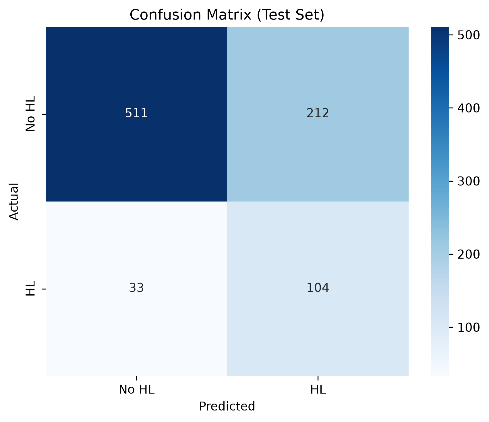
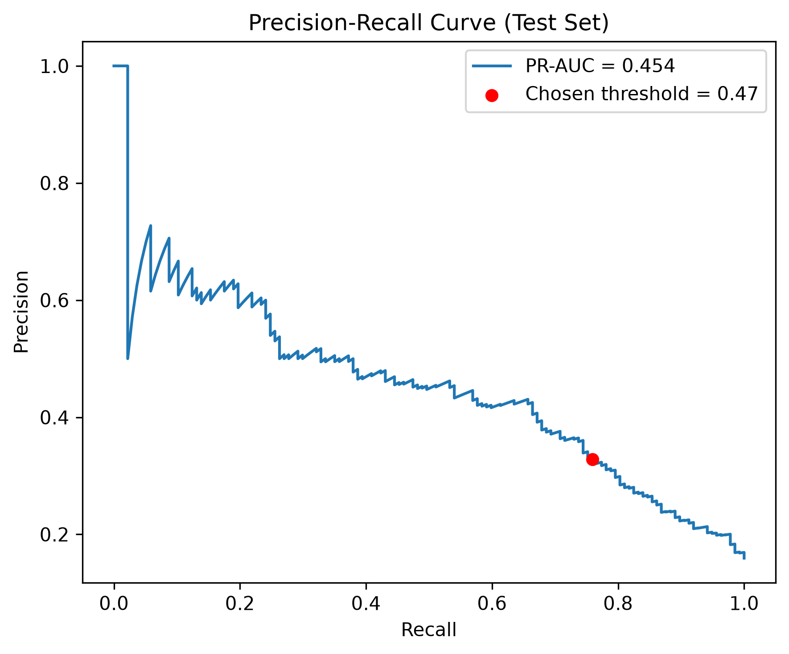
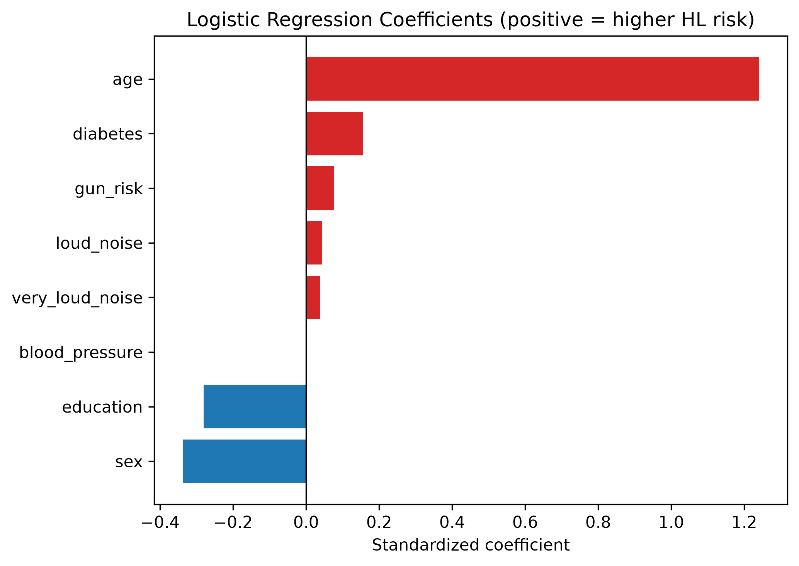

# Data Analytics Project Plan
## Predicting Hearing Loss from Routine Health Data (NHANES 2015–2016)

**Kasra Bagherian**

---

## 1. Introduction

Hearing loss is one of the most common sensory impairments worldwide, yet it frequently goes undiagnosed because testing requires specialized equipment and a clinic visit. At the same time, many of the known risk factors for hearing loss — age, noise exposure history, chronic conditions like diabetes, and basic vitals — are already collected during routine health surveys and primary-care visits.

This project explores whether a predictive model can flag individuals at risk of hearing loss using only these general health indicators, **without a hearing test**. If such a model works well enough, it could be used as a low-cost screening tool: clinics could run the model on data they already collect and refer high-risk patients for a full audiological evaluation.

The dataset used is from the CDC's **National Health and Nutrition Examination Survey (NHANES), 2015–2016 cycle** — a large, publicly available, nationally representative survey that includes both the risk-factor data and a gold-standard audiometry exam (the hearing test results used to define our outcome variable).

The project follows the **data science pipeline**: data sourcing → ingestion → engineering → analytics/modeling → visualization → deliverables.

---

## 2. Data Source

**Source:** CDC NHANES 2015–2016, publicly available at [wwwn.cdc.gov/nchs/nhanes](https://wwwn.cdc.gov/nchs/nhanes/)

**Format:** Eight SAS transport files (`.XPT`), covering demographics, audiometry exams, audiological questionnaires, body measures, blood pressure, blood lead/cadmium, medical conditions, and diabetes status.

**Size:** 4,309 participants (adults aged 20–69 who completed the audiometry exam), 21 columns after feature construction.

### Sample Data (first 5 rows of the master table)

| seqn | sex | age | military | education | income_ratio | firearm_protection | loud_noise | bmi | blood_pressure | diabetes | hl_presence |
|------|-----|-----|----------|-----------|-------------|-------------------|------------|------|---------------|----------|-------------|
| 83732 | Male | 62 | No | College+ | 4.39 | Gun ≤50% prot. | No Exposure | 27.8 | 120 | Yes | 0 (No) |
| 83733 | Male | 53 | No | High School | 1.32 | No Gun | No Exposure | 30.8 | 137 | No | 1 (Yes) |
| 83735 | Female | 56 | No | College+ | 5.00 | No Gun | No Exposure | 42.4 | 135 | No | 1 (Yes) |
| 83736 | Female | 42 | No | College+ | 1.23 | No Gun | No Exposure | 20.3 | 106 | No | 0 (No) |
| 83741 | Male | 22 | No | College+ | 2.08 | No Gun | No Exposure | 28.0 | 112 | No | 0 (No) |

### Data Dictionary (key features)

| Feature | Type | Description |
|---------|------|-------------|
| age | Continuous | Age in years (20–69) |
| sex | Binary | Male / Female |
| education | Ordinal (1–3) | Below HS / HS / College+ |
| income_poverty_ratio | Continuous | Family income ÷ poverty line |
| loud_noise | Ordinal (1–3) | Occupational noise exposure level |
| very_loud_noise | Ordinal (1–3) | Very loud occupational noise level |
| firearm_and_protection | Ordinal (1–3) | Firearm use and hearing protection |
| bmi | Continuous | Body Mass Index |
| blood_pressure | Continuous | Mean systolic BP (mmHg) |
| diabetes | Binary | Doctor-diagnosed diabetes |
| heart_disease, stroke, cancer | Binary | Self-reported conditions |
| **hl_presence** (target) | **Binary** | **Hearing loss present (worse-ear PTA > 25 dB)** |

---

## 3. Pipeline Stages

### Stage 1 — Data Ingestion
**Estimated time: 3 hours**

**What was done:** Downloaded the eight raw `.XPT` files from the CDC servers using an automated Python script, then loaded every file into a local **PostgreSQL** database (containerized with Docker) as its own table. This made the raw data queryable with SQL and kept the ingestion fully reproducible.

**Tools:** Python (`urllib`, `pyreadstat`, `SQLAlchemy`), PostgreSQL, Docker

**Anticipated result — project pipeline:**

```
CDC Servers (.XPT files)
        │  Python download script
        ▼
    data/raw/*.XPT
        │  Python loader script
        ▼
    PostgreSQL Database (8 raw tables)
        │  SQL join query
        ▼
    data/processed/raw_master_table.csv  (4,309 rows × 21 cols)
```

---

### Stage 2 — Data Engineering (EDA & Cleaning)
**Estimated time: 15 hours**

This was the most time-intensive stage. The work included exploratory data analysis (EDA) to understand distributions and patterns, handling missing data, and preparing the dataset for modeling.

#### Understanding Distributions

The first step was to visualize the distribution of every feature to understand what we are working with — skewness, outliers, class balance, and general data quality.

**Continuous features** (age, BMI, blood pressure, income-to-poverty ratio):


**Ordinal features** (noise exposure levels, firearm exposure, education):


**Binary features** (sex, diabetes, heart disease, etc.):


**Target variable distribution** — hearing loss is present in only ~16% of the sample, creating a class imbalance that had to be addressed during modeling:

.png)

#### Understanding Missingness

NHANES has structured missing data due to its survey skip-logic (e.g., the "very loud noise at work" question was only asked to people who already said they experienced loud noise). A correlation heatmap of NULL values was used to understand which columns had related missingness:


#### Exploring Relationships with Hearing Loss

Continuous features plotted against the target variable:


Categorical/ordinal features plotted against the target variable:


Correlation matrix for continuous features:


#### Cleaning Steps

- Handled skip-logic NULLs with logic-based recoding (not statistical imputation)
- Tested lead & cadmium columns (55% missing) for predictive value — they showed no improvement, so they were dropped
- Imputed remaining missing values appropriately
- Split the data into train/test sets (stratified by the target variable)

---

### Stage 3 — Analytics / Computation (Modeling)
**Estimated time: 10 hours**

**What was done:**
- Compared five classifiers (Logistic Regression, Random Forest, XGBoost, KNN, Gaussian Naive Bayes) using 5-fold stratified cross-validation
- Scored models using **PR-AUC** (Precision-Recall Area Under Curve) rather than accuracy, because the target class is imbalanced (~16% positive)
- Tuned the decision threshold to maximize **F2 score** (which weights recall more than precision), since missing a real hearing-loss case is worse than a false alarm
- Logistic Regression performed best, which was consistent with the EDA showing mostly linear relationships between predictors and the target

**Results on held-out test set:**

| Metric | Cross-Validation | Test Set |
|--------|-----------------|----------|
| PR-AUC | 0.475 | 0.454 |
| F2 | 0.637 | 0.602 |
| Precision | — | 0.329 |
| Recall | — | 0.759 |

The model catches ~76% of true hearing-loss cases, trading off a higher false-alarm rate — a deliberate choice for a screening tool.

---

### Stage 4 — Visualization (Results)
**Estimated time: 4 hours**

The key visualizations produced for communicating results:

**Confusion Matrix** — shows the model's predictions vs. actual labels on the test set:



**Precision-Recall Curve** — illustrates the tradeoff between precision and recall at different thresholds:



**Model Coefficients** — shows which features the logistic regression model weighted most heavily:



Age is by far the strongest predictor. Diabetes, noise exposure, and being male are associated with higher risk; higher education is associated with lower risk.

---

## 4. Time Estimate Summary

| Pipeline Stage | Estimated Hours |
|---------------|----------------|
| Data Ingestion (download, load, SQL joins) | 3 |
| Data Engineering (EDA, cleaning, missing data) | 15 |
| Analytics / Modeling (training, tuning, evaluation) | 10 |
| Visualization (plots, result figures) | 4 |
| Deliverables (report writing, packaging) | 3 |
| **Total** | **35** |

---

## 5. Deliverables

The following deliverables would be provided to stakeholders:

1. **Written Report (PDF)** — A document summarizing the problem, methodology, findings, and limitations. Includes all key visualizations and a discussion of how the model could be used as a screening tool.

2. **Slide Deck (PDF)** — A concise presentation covering the project motivation, pipeline, key results, and next steps. Suitable for a non-technical audience.

3. **Python Codebase (GitHub Repository)** — The full, reproducible pipeline:
   - `src/` — Data download and database loading scripts
   - `sql/` — SQL query and data dictionary
   - `notebooks/` — EDA, cleaning, and model training notebooks
   - `docker-compose.yml` — One-command database setup
   - `requirements.txt` — All Python dependencies

4. **Trained Model** — The final logistic regression model, ready to generate risk scores on new patient data.

**Delivery method:** GitHub repository link shared with the team, plus PDF report and slides delivered via email or course submission portal.

---

## 6. Limitations & Future Work

- The model finds associations, not causal relationships (cross-sectional data).
- NHANES survey weights are not applied, so results describe patterns in the sample rather than nationally weighted estimates.
- **Future direction:** Extend the binary model to a multiclass classifier that predicts hearing loss *severity* (mild / moderate / severe) using the `hl_severity` column already constructed in the pipeline.
